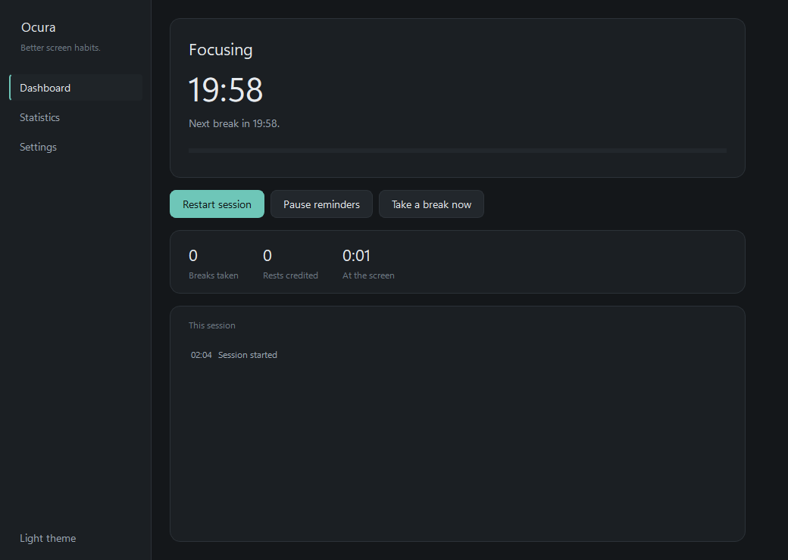
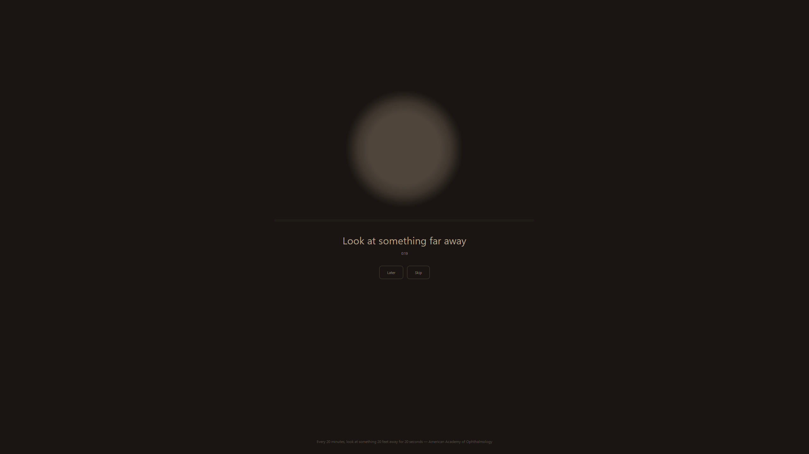
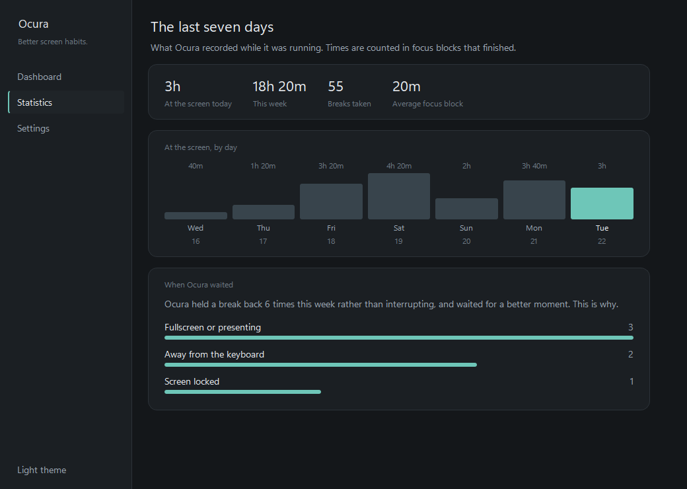
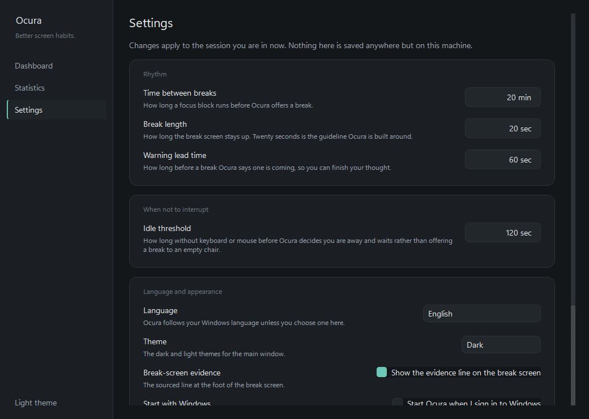

# Ocura

**Better screen habits.**

Ocura is a calm, privacy-first eye-care and screen-habit companion for Windows.
It watches how long you have been at the screen and offers a break when one is
due — and, crucially, tries to offer it at a moment that is actually good for
you.

Ocura is a wellness and productivity tool. It is not a medical device, it does
not diagnose anything, and it makes no medical claims.

## What it looks like

Screenshots are taken from the running application by `scripts/screenshots.py`,
which starts Ocura against a throwaway profile and grabs the real windows. They
are regenerated rather than retouched, so a screenshot that stops matching the
product is a command away from being right again.

**The dashboard**, at the start of a focus block. It is a glance surface: what
is happening, how long until the next break, and nothing that moves.



**The break screen**, across every monitor. Dim, warm, and low-contrast on
purpose — the instruction is to look away from it, so it is not designed to be
looked at. *Later* defers the break, *Skip* ends it; neither is hidden.



**Statistics**, over the last seven days — including why Ocura held a break
back rather than interrupting, which is the number that says whether the
context detection is earning its place.



**Settings.** Everything here is a fact about your machine and stays on it.



The history behind the statistics screenshot is a generated demonstration
profile, not anyone's real week. Everything else in these images is the
application in its default state.

## Philosophy

**It must earn the right to interrupt.** An interruption at the wrong moment is
worse than no interruption at all. Every feature in Ocura is judged by whether
it improves the quality of the interruption decision, not by how many
notifications it can produce.

**Calm, never guilt-driven.** No streaks to break, no failure states, no
red numbers, no "you missed 4 breaks today". Metrics exist to inform you, never
to accuse you. A break you skipped is not a moral event.

**No forced breaks.** You can defer a break, and you can end one early. Ocura
never locks you out of your own machine.

**Windows-first.** Ocura is built for Windows rather than ported to it. The
context signals that make the interruption decision good — session lock, full
screen, display state — are platform-specific by nature.

**Privacy-first and local-first.** No accounts, no sign-in, no cloud sync, no
telemetry, no analytics. Nothing leaves the machine. The history database
carries no user identifier of any kind — not a UUID, not a machine ID, not a
hashed one — and a test reads the real `PRAGMA table_info` of a migrated file
to keep it that way.

## Current status: P7, packaging

P0 built the framework-free core, P1 the Windows detectors that decide when
interrupting is appropriate, and P2 the first user-visible surface. Since then:
the break experience across every screen (P3), a SQLite history and the
statistics read from it (P4), settings and a first run (P5), and three
languages with the layout turning round for Arabic (P6).

P7 is where it is now. There is a Windows installer, and a release workflow
that builds one from a tag. There is no code signing, so Windows will warn
about the publisher.

The table says what is true of the code today, not what a phase was meant to
contain. Anything not finished is named as such rather than left out.

| Area | Status |
| --- | --- |
| Break state machine (focus, break, pause, defer, satisfaction) | Implemented |
| Monotonic elapsed time, separate calendar clock | Implemented |
| Schedule validation | Implemented |
| Deferral and satisfaction as distinct outcomes | Implemented |
| Deterministic test suite | Implemented |
| Rest credit from session lock, expiring and spent once | Implemented |
| Windows context detection (idle, session lock, fullscreen, screensaver) | Implemented |
| Tray icon, main window, navigation | Implemented |
| Live dashboard | Implemented |
| Dark and light themes from one token set | Implemented |
| Type and spacing scales, reduced-motion support | Implemented |
| Pre-break warning, break overlay on every screen | Implemented |
| Skip, and snooze capped at two | Implemented |
| SQLite history, versioned schema, no user identifier | Implemented |
| Settings, validated, persisted with the history | Implemented |
| First-run introduction | Implemented |
| Statistics over the last seven days, including why breaks were held back | Implemented |
| Arabic, German and English, with the layout mirrored for Arabic | Implemented |
| Start with Windows, from Settings or the installer | Implemented |
| Windows installer, per-user, no administrator | Implemented |
| Release from a tag, with the installer attached | Written; never yet run against a real tag |
| Code signing | Not done. Builds are unsigned and Windows says so |
| An icon designed at 16px | Not done. The mark is still the P2 illustration |
| Fullscreen on a **non-primary** display | Not detected. Known limitation, see below |
| Overlay reconciliation when a monitor is physically unplugged | Pending hardware confirmation |

The last two rows are limitations rather than unfinished work, and each is
written up where it was found: the non-primary display in
[docs/architecture.md](docs/architecture.md#known-limitation-fullscreen-on-a-non-primary-display),
and the monitor change in the same file under the overlay. Reconciliation is
verified by simulating the screen list, because a monitor cannot be unplugged
from a test; Qt's real `screenRemoved` timing on a physical disconnect
mid-break has not been observed yet. See [docs/ROADMAP.md](docs/ROADMAP.md).

## Development

Requires Python 3.12 or newer.

```powershell
python -m venv .venv
.venv\Scripts\Activate.ps1
python -m pip install -e ".[dev]"
```

Run Ocura:

```powershell
python -m ocura.ui.app
```

Closing the window hides it to the tray; quit from the tray menu.

Run the tests:

```powershell
pytest                  # everything
pytest -m "not gui"     # skip anything needing a display
```

Run the linter and the formatter check:

```powershell
ruff check .
ruff format --check .
```

The suite is fully deterministic and never sleeps: tests drive a fake clock and
advance it instantly, so the whole run takes well under a second.

## Troubleshooting

**Windows warns that the publisher is unknown.** Ocura is not code-signed, so
SmartScreen shows "Windows protected your PC" the first time you run
`Ocura.exe` or the installer. Choose **More info**, then **Run anyway**. That
warning means only that the publisher has not paid for a certificate — it is
not a report about the file. The warning is expected and there is no way to
suppress it short of buying a certificate.

**The tray icon is missing.** Windows files newly seen tray icons into the
hidden overflow area — the chevron to the left of the clock — rather than the
taskbar itself. Ocura is running and the icon is there; drag it out of the
overflow onto the taskbar once and Windows will remember. There is no API to
promote an icon out of the overflow, so this cannot be fixed in code.

Ocura logs `tray icon shown` at startup, and logs an error if the system reports
no tray is available.

## Architecture

Domain -> Application -> Infrastructure -> UI, with dependencies pointing
inwards only. The domain layer imports no Qt, no `ctypes`, and no Windows API,
which is what let the UI and the Windows detectors be added without touching
the break logic, and what keeps the break rules testable without a display. See [docs/architecture.md](docs/architecture.md).

## Trial build

```powershell
.venv\Scripts\python.exe scripts\build_release.py
```

One command: it runs ruff and pytest first and refuses to build if either
fails, packages with `packaging\ocura.spec`, adds the licence notices and a
read-me, checks the result can find its own resources, and prints the path.

The output is `dist\Ocura\` — hand over the **whole folder**, the executable
alone will not run. It is gitignored and never committed.

`--onedir` is an obligation, not a preference: PySide6 ships Qt under the
LGPL v3, which requires that the recipient can replace the Qt libraries, and a
one-file build unpacks to a temporary directory with nothing durable to
replace. See `licenses/THIRD_PARTY_NOTICES.md`.

`--installer` goes one step further: after the folder is built it compiles
`packaging\ocura.iss` with Inno Setup 6 and leaves
`dist\Ocura-<version>-Setup.exe` beside it:

```powershell
.venv\Scripts\python.exe scripts\build_release.py --installer
```

The installer is per-user and asks for no administrator. It installs under
`%LOCALAPPDATA%\Programs\Ocura`, offers the same start-with-Windows choice
Ocura's own first run does — both read the same registry value, so they cannot
disagree — and on uninstall it leaves your history and settings where they are
unless you tick the box asking for them to go too.

The version number is never typed into either of those files. It is written
once, in `src/ocura/__init__.py`, and `tests/unit/test_version.py` fails if a
second copy of it appears anywhere in the repository.

For a shortcut on your Desktop pointing at the last build:

```powershell
.venv\Scripts\python.exe scripts\make_shortcut.py
```

If a build does not start on someone else's machine:

```
Ocura.exe --self-check > selfcheck.txt
```

reports whether the bundle resolved its icon and stylesheet, without needing a
console window.

### Why assets live inside the package

Icons and the stylesheet live in `src/ocura/ui/assets/` and `src/ocura/ui/`,
not at the repository root, because they are **package data** and have to
travel inside the bundle. A path built relative to the repository — or from
`__file__` and a few `parents[n]` — resolves fine while you are running from a
checkout and stops resolving the moment the app is frozen, because the person
running the executable has no repository. Everything is therefore loaded through
`importlib.resources`, which reads from the source tree and from the bundle
identically, and the PyInstaller spec copies those files to the same import path
so neither route has to know which one it is on.

## Licensing

Ocura is **source-available, not open source**.

- Free for personal use.
- The source is published for transparency and evaluation. You can read it and
  audit what the application does.
- You may not use, copy, modify, distribute, sublicense, or sell this software
  or any derivative work without a written commercial license.

See [LICENSE](LICENSE) for the exact terms.

Commercial enquiries: **Abdalrhim19991@gmail.com**

Copyright (c) 2026 Abdulrahim Ramadan. All rights reserved.
